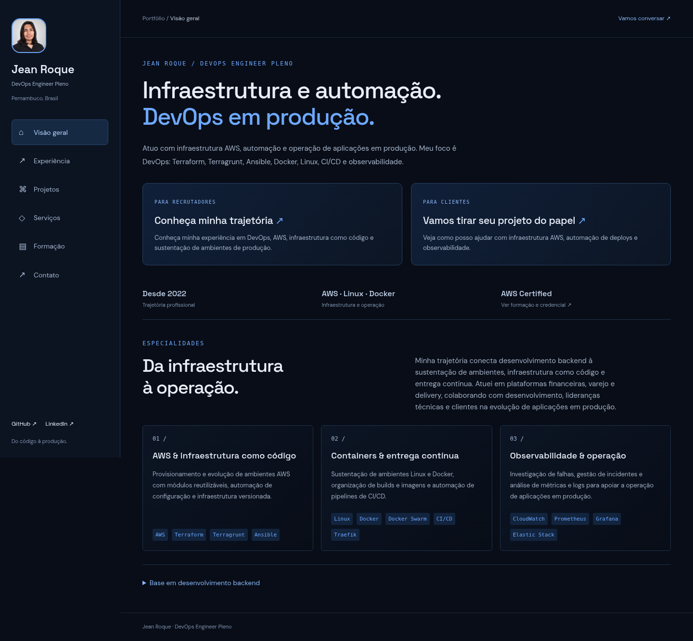

<div align="center">

# Jean Roque

**Backend Developer · Software Engineer**

APIs, integrações e sistemas que funcionam em produção.

[Portfólio](https://jeanroque0.github.io/) · [Experiência](https://jeanroque0.github.io/experiencia/) · [Projetos](https://jeanroque0.github.io/projetos/) · [LinkedIn](https://www.linkedin.com/in/jean-roque-579a48348/)

</div>

---

## Olá! 👋

Sou desenvolvedor Backend, de Pernambuco, com experiência em **Node.js, TypeScript, PHP e Go**. Minha trajetória passa por plataformas financeiras, varejo e delivery, trabalhando com APIs REST, integrações entre serviços, bancos de dados e evolução de aplicações em produção.

Meu foco profissional é **desenvolvimento Backend e Engenharia de Software**: implementar funcionalidades, organizar a arquitetura, investigar gargalos e construir sistemas de fácil manutenção.

Minha experiência em DevOps e AWS complementa essa atuação. Ela me ajuda a considerar deploy, observabilidade e confiabilidade nas decisões de desenvolvimento.

## Onde posso contribuir

- **APIs e integrações:** desenvolvimento e manutenção de serviços backend, integração com plataformas externas e implementação de regras de negócio.
- **Arquitetura e qualidade:** organização do código com SOLID, injeção de dependências, orientação a objetos e Design Patterns.
- **Dados e performance:** modelagem, consultas e investigação de gargalos em APIs e bancos de dados.
- **Evolução de sistemas:** desenvolvimento de funcionalidades, troubleshooting e colaboração com produto, QA e equipes de engenharia.

## Stack principal

| Área | Tecnologias |
| :--- | :--- |
| **Linguagens e runtime** | TypeScript · Node.js · PHP · Go |
| **Frameworks** | NestJS · Express · Laravel · Symfony |
| **Persistência** | PostgreSQL · MySQL · Redis · TypeORM · Doctrine |
| **Práticas** | APIs REST · SOLID · Injeção de dependências · Clean Code · Git |

<details>
<summary><strong>Experiência complementar e estudos</strong></summary>

**Produção e entrega:** AWS, Docker, Linux, Terraform, Terragrunt, Ansible e CI/CD.

**Observabilidade:** CloudWatch, Prometheus, Grafana, ELK e Datadog.

**Projetos e estudos:** Rust, C++, Python e automação de navegadores com Selenium.

</details>

## Experiência aplicada

**MB Labs — Backend e DevOps**

Desenvolvimento de uma plataforma bancária white-label, com contas digitais, cartões de loja, cashback e integrações bancárias. APIs com Node.js, TypeScript, Express, InversifyJS, TypeORM e PostgreSQL. Posteriormente, atuação na automação e sustentação de ambientes AWS.

**Pigz — Desenvolvimento Backend e Engenharia de Software**

Evolução de sistemas de varejo e delivery, incluindo estoque, PDV e atendimento. Desenvolvimento com Go, Node.js, TypeScript e PHP, otimização de consultas e APIs e participação na modernização da infraestrutura AWS.

**A&3 Tecnologia — DevOps**

Sustentação de ambientes Linux e containers, automação operacional e organização de builds e imagens.

[Ver cargos, períodos e detalhes no portfólio →](https://jeanroque0.github.io/experiencia/)

## Projetos

### Swing Music — seu próprio music player

Playbook Ansible para implantação automatizada do Swing Music em ambientes Linux, com provisionamento da aplicação e configuração de serviços para um music player self-hosted.

**Categoria:** DevOps · **Stack:** Ansible, Linux

[Ver repositório →](https://github.com/Jean-V0/swing-music-playbook) · [Explorar no portfólio →](https://jeanroque0.github.io/projetos/)

Minha experiência com sistemas financeiros e de varejo está descrita na trajetória profissional.

## Vamos trabalhar juntos?

**Para recrutadores:** meu foco está em oportunidades de **Backend Developer, Backend Engineer e Software Engineer**, especialmente com Node.js, TypeScript, PHP/Laravel ou Go.

**Para clientes:** posso contribuir com desenvolvimento e evolução de APIs e integrações entre sistemas. A conversa inicial serve para entender o problema e definir escopo, prazo e critérios de entrega.

[Conheça os serviços →](https://jeanroque0.github.io/servicos/) · [Converse comigo no LinkedIn →](https://www.linkedin.com/in/jean-roque-579a48348/) · [Envie um e-mail →](mailto:jeanvdsroqu@gmail.com)

<details>
<summary><strong>Formação e certificação</strong></summary>

- **Full Cycle — Engenharia de Software:** janeiro a junho de 2023. Arquitetura de software, backend, comunicação entre sistemas, cloud e DevOps.
- **DIO — Linux e Java Experience:** junho a agosto de 2022. [Perfil na plataforma](https://web.dio.me/users/jeanvdsroque).
- **AWS Certified Cloud Practitioner:** emitida em dezembro de 2024, com expiração em dezembro de 2027. [Validar credencial](https://www.credly.com/badges/ff8b9070-08b2-48a2-9066-9368060827d2/linked_in_profile).

</details>

---

## Este portfólio

Este repositório contém meu site pessoal, desenvolvido com **React + TypeScript + Vite**, CSS puro e uma identidade visual em azul sobre fundo escuro.



O site tem navegação por áreas, caminhos para recrutadores e clientes, projetos com filtros e detalhes em janela, serviços com contato por e-mail, formação e credencial AWS. Cada área tem HTML pré-renderizado e URL própria, mantendo o conteúdo acessível antes de carregar JavaScript. Fontes são servidas localmente. O layout se adapta a desktop e celular, com navegação por teclado e suporte à preferência por movimento reduzido.

### Executar localmente

Com **Node.js 22.12+** instalado:

```bash
npm ci
npm run dev
```

Abra o endereço exibido no terminal.

| Comando            | Função                                            |
| :----------------- | :------------------------------------------------ |
| `npm run dev`      | Inicia o servidor de desenvolvimento              |
| `npm run build`    | Verifica TypeScript e gera o site em `dist/`      |
| `npm run preview`  | Serve o build de produção localmente              |
| `npm run lint`     | Executa a análise estática do código              |
| `npm run test:e2e` | Verifica navegação, acessibilidade e SEO no build |

### Personalizar e publicar

Os dados do portfólio ficam em [`src/data/profile.ts`](src/data/profile.ts), os serviços em [`src/data/services.ts`](src/data/services.ts) e as URLs e descrições de SEO em [`src/data/site.ts`](src/data/site.ts). A publicação no **GitHub Pages** está preparada em um [workflow do GitHub Actions](.github/workflows/deploy.yml).

Para ativar, selecione **GitHub Actions** em **Settings → Pages** e execute o workflow após enviar o projeto para a branch `main`.

[Guia de desenvolvimento e publicação →](docs/desenvolvimento.md)

---

<div align="center">

**Vamos conversar sobre seu próximo desafio?**

[LinkedIn](https://www.linkedin.com/in/jean-roque-579a48348/) · [jeanvdsroqu@gmail.com](mailto:jeanvdsroqu@gmail.com)

</div>
